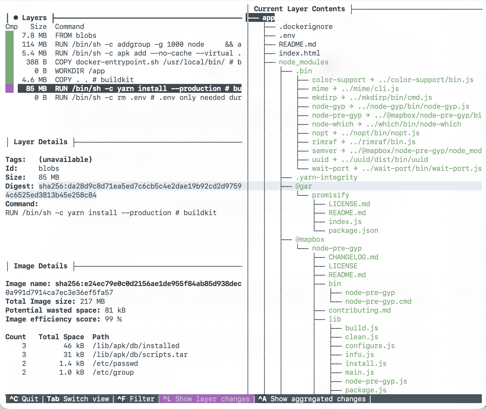

#+title: Isolation Part 1 - Answers

* Q1: What is the issue here?
The *.env* file gets bundled with the docker image.

* Q2: Can you recover the actual secrets from the image? Describe how you would do this and include a screenshot of the recovered secrets.

Yes, by connecting to the docker container, and verifying checking */app/.env*.

#+begin_src sh
  > docker exec -it <container-id> cat /app/.env

  API_KEY=430b3b1c-2535-4d96-855f-7d2b352552ca
  USER=user01_team10
#+end_src

[[file:screenshots/screenshot-dotenv.png]]

* Q3: What do you think of Tom’s fix?
At first glance, looks fine. The *.env* file is not longer present under */app* and the program *find* does not return anything useful.
#+begin_src sh
  > docker exec -it <container-id> find . -iname "env"

  /usr/bin/env
#+end_src

Something that pops into mind is if we can reverse engineer *rm* in order to find something that traces back to file.

A quick ai-assisted google search with the title: "reverse engineer rm" yields the following answer:

#+begin_quote
AI Overview:
(...)
Because rm only destroys the metadata pointers (the map to the data) rather than overwriting the actual data blocks, the physical bits remain on your drive temporarily.
(...)
#+end_quote

* Q4: Is it possible to recover the new API key now?

** docker dive
https://github.com/wagoodman/dive

From this we can see that each command present in a Dockerfile maps to
something called a *layer*.
It seems like we can inspect an intermediate layer in order to retrieve the *dotenv*..

Note: There is an Extract option when focusing in the tree view of *docker dive*, but there is a bug where this option is not properly working atm (at least using macOs)
Issue: https://github.com/wagoodman/dive/issues/687)
Fix: https://github.com/wagoodman/dive/pull/693 (not yet merged)

** docker save

https://docs.docker.com/reference/cli/docker/image/save/
This utility will help us get a hold of layers

Layers are compressed blobs under blobs/sha256/
  For each blob, we can:
  1. extract it
  2. grep for the *dotenv*
  3. if found, keep it

#+begin_src sh
    > ./scripts/run.sh

    found in: tmp/blobs/sha256/<blob-id>
    extracted: app/.env
    API_KEY=1a337a1c-2fa2-4502-874f-9be76f3c94ed
    USER=user02_team10
#+end_src

[[file:screenshots/screenshot-recovered.png]]

Note: https://github.com/wagoodman/dive/issues/336#issuecomment-1530196172

* Q5: So, how would you go about doing Scott’s job? Would you do something different?

1. Never place a *dotenv* in the image itself
   1. Provide it as a variable for example
2. Use .dockerignore to make sure no secrets leak by accident

[[file:screenshots/var-during-build.png]]

source: https://www.docker.com/blog/docker-best-practices-using-arg-and-env-in-your-dockerfiles/
